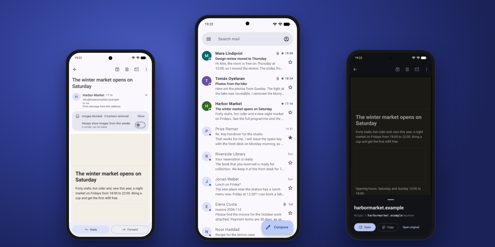

<div align="center">


# Plico

**Open-source email app for Android.**<br>
Fast push for IMAP mail without Google. Private, minimal and secure. No trackers, no Google Play
Services.

[](#build)
[](#security)
[](https://github.com/Turtlecute33/Plico/releases)
[](LICENSE)



</div>

## About

Plico is an email app for IMAP accounts on Android 15 and later. You type your address, and Plico
finds the servers. New mail arrives in seconds through IMAP IDLE. Plico uses no Firebase and no
server of its own.

Plico has its own IMAP, SMTP and MIME code, and only a few libraries. It reads untrusted mail with
JavaScript off and with no network access, and it shows the true target of each link before it
opens.

## Features

- **Any IMAP account**: SSL/TLS or STARTTLS. Setup finds the servers from your address. You can also
  enter them yourself. Plico never connects without encryption.
- **Fast push**: IMAP IDLE with one connection for each account and keep-alives that adapt to the
  network. Servers without IDLE get a check at an interval.
- **Unified inbox**: all accounts in one list, and folders and labels for each account. Swipe
  actions, multi-select, local and server search.
- **Clear message list**: unread mail gets bold text, a dot and a colour for each sender. Sender
  logos are optional and off by default.
- **Gmail**: app password, Google sign-in in the browser, or the Google account on the phone. Archive,
  labels, Important, notification categories, Spam and Trash.
- **Outlook.com and Microsoft 365**: sign-in in the browser with your own Microsoft client.
- **Riseup**: the server folders, aliases as identities, quota, and links to the account settings.
- **Offline**: the mail of the last 30 days stays on the phone, and older mail opens on demand. You
  can also keep all mail offline.
- **Compose**: plain text, attachments from the photo picker and the file picker, Undo send.
- **Material 3 Expressive**: your wallpaper colours, light and dark, and dark mode for email.

## Security

- **Encryption only**: Plico refuses plaintext IMAP and SMTP, and "STARTTLS if available". Passwords
  go only through TLS.
- **System CAs only**: a CA that you or an admin add is not trusted. Certificate transparency on
  Android 16 and later.
- **Safe message view**: Plico cleans HTML with jsoup before it shows it. The WebView has
  JavaScript, cookies, storage and file access off. It cannot load from the network, except remote
  images after you tap Show.
- **Link checks**: each link opens a sheet first. The sheet shows the domain in bold and the full
  link without trackers. It warns when the link text shows a different domain, and for IP
  addresses and mixed-script domains.
- **Sender checks**: a warning for a first message from an address, for a display name that shows a
  different address, and for a different Reply-To domain. On Gmail, a warning when DMARC fails.
- **Attachments**: Plico checks the file type from its first bytes and warns about risky types,
  such as APK, HTML and SVG files.
- **Secrets**: passwords and tokens are encrypted with an Android Keystore key.
- **App lock** with fingerprint or screen lock, a guard against overlays on Send and Delete, and an
  option to block screenshots.
- **Memory tagging** (MTE) in sync mode on phones that have it, such as Pixel 8 and later.

## Privacy

- No analytics, no crash reporting, no Google Play Services, no account with us.
- **Remote images are blocked** and tracking pixels are removed. Links lose their tracking
  parameters.
- **Outgoing mail** has no device name, no time zone and no app name. Plico removes location data
  from photos before it sends them.
- **No backups**: mail, accounts and settings stay out of cloud backup and device transfer.
- **Keyboard**: compose and search fields ask the keyboard not to learn from your text.
- **Notifications** can hide the sender and the subject.
- Plico connects only to:
  - your IMAP and SMTP servers;
  - Google or Microsoft sign-in, if you use it;
  - the autoconfig address of your mail domain (HTTPS) and DNS, only when you add an account. Plico
    sends only the domain, never your address;
  - the logo source that you select, only when you turn on sender logos: DuckDuckGo, Google, or the
    website of each sender (and the hosts that it redirects to);
  - remote content and unsubscribe pages, only after you tap.

Gmail adds the public IP address of the sender to each message that it sends. Riseup removes it.

## Download

Get the APK from [Releases](https://github.com/Turtlecute33/Plico/releases). Plico is new software.
Report problems in [Issues](https://github.com/Turtlecute33/Plico/issues).

Before you install, check the signing certificate. Its SHA-256 fingerprint is:

```text
2625a6b97f7465527e9ad0c0d2704efcd8dff2e3a8c4fff708fa21c8f0d906c3
```

Compare it with the output of `apksigner verify --print-certs <file>.apk`, or use AppVerifier.
Do not install an APK with a different certificate.

For fast push, allow notifications and let Plico run without battery limits when it asks.

## Build

Requirements: JDK 21 and the Android SDK with platform 37.

```sh
JAVA_HOME=/opt/homebrew/opt/openjdk@21 ./gradlew :app:assembleDebug :app:testDebugUnitTest
```

Release builds are signed with the key that `scripts/make-release-key.sh` makes. The passwords stay
in the macOS Keychain. Without the key, `assembleRelease` makes an unsigned APK. The release APK is
about 4.6 MB (estimate for 0.2.4).

<details>
<summary><b>Gmail with Google sign-in (optional)</b></summary>

An **app password** works without setup. It needs 2-Step Verification on the Google account:
<https://myaccount.google.com/apppasswords>.

Google sign-in needs an OAuth client that you own, because Google ties the client to the package
name and the signing key of the app:

1. In the Google Cloud console, make a project and configure the OAuth consent screen: "External",
   publishing status "In production", and a support email that is not personal.
2. Make an OAuth client of type **Android** with the package name `app.plico` and the SHA-1 of the
   key that signs your build. Debug builds use the package `app.plico.debug` and need their own
   client.
3. In Plico, open Settings → Sign-in clients → Google client ID and paste the client ID. You can
   also paste it on the setup page "Use your own Google OAuth client". For debug builds, you can
   also set `plico.googleClientId=<id>` in `local.properties`.

Google shows an "unverified app" screen at sign-in. This is normal for a personal client. Release
builds never contain a client ID. If you publish an APK, sign it with a different key than your
personal build.

</details>

<details>
<summary><b>Outlook.com and Microsoft 365 (optional)</b></summary>

Microsoft lets an app open a mailbox only through a registered client. Plico has no client of its
own, so you register one. You need a directory: a work account or a free Azure account.

1. Open the Microsoft Entra admin center: <https://entra.microsoft.com/>.
2. Go to App registrations → New registration. For the account types, select "Any Entra ID tenant
   and personal Microsoft accounts".
3. Go to Authentication → Add a platform → Mobile and desktop applications. Add the redirect URI
   `app.plico://oauth2redirect`. Debug builds use `app.plico.debug://oauth2redirect`.
4. Copy the Application (client) ID. In Plico, paste it on the setup page "Use your own Microsoft
   client" or in Settings → Sign-in clients → Microsoft client ID. For debug builds, you can also
   set `plico.microsoftClientId=<id>` in `local.properties`.

Outlook.com: first turn on IMAP. In Outlook.com, go to Settings → Mail → Forwarding and IMAP, and
turn on IMAP for devices and apps. A work or school account can need the approval of its
administrator. If the administrator turned off SMTP AUTH for the mailbox, Plico can receive mail but
cannot send it.

Microsoft keeps the access of Plico after you remove the account. To stop it, go to
<https://account.live.com/consent/Manage> (personal account) or <https://myapps.microsoft.com>
(work or school account).

</details>

<details>
<summary><b>Other accounts</b></summary>

Type your address and select Next. Plico looks for the servers in its built-in list, then in the
autoconfig file of your mail domain (HTTPS), then in DNS. It sends only the domain, never your
address. If it finds nothing, or if you select "Enter the server settings yourself", enter the
servers from the help pages of your provider.

Some providers need an app password or IMAP access turned on; setup tells you when it knows this.
Proton Mail, Tuta and HEY have no IMAP access that Plico can use.

</details>

<details>
<summary><b>How push works</b></summary>

- One foreground service keeps one IMAP IDLE connection open for each account. The server tells
  Plico about new mail at once.
- Plico learns, for each server and network, how long a quiet connection stays open. The refresh
  interval becomes longer while the connection stays alive, and shorter after a failure. When the
  server sends its own keep-alives, Plico uses them.
- One exact alarm serves all accounts. Each wake does the work that is due for all accounts
  together.
- Each account can use instant push, instant push on Wi-Fi only (a check at an interval on mobile
  data), or a check at an interval.
- Without a network, Plico closes the connections and waits for the network.

</details>

<details>
<summary><b>Project layout</b></summary>

- `mail/`: IMAP, SMTP, MIME and SASL in pure Kotlin, with no Android imports and no dependencies.
- `app/src/main/kotlin/app/plico/account`: providers, server discovery, sign-in and credentials.
- `app/src/main/kotlin/app/plico/data`: SQLite database, settings, Keystore vault, files.
- `app/src/main/kotlin/app/plico/sync`: mailbox sync, pending operations, send, drafts, search.
- `app/src/main/kotlin/app/plico/push`: foreground service, alarms, network watch, keep-alives.
- `app/src/main/kotlin/app/plico/html`: HTML cleaner, link checks, sender checks, sender logos.
- `app/src/main/kotlin/app/plico/notify`: notifications.
- `app/src/main/kotlin/app/plico/ui`: theme, shared components, navigation and screens.
- `docs/DESIGN.md`: the design, with the research in `docs/research/` and the reviews in
  `docs/review/`.

</details>

<details>
<summary><b>Validation</b></summary>

Run the JVM tests, lint and the two builds:

```sh
./gradlew :mail:testDebugUnitTest :app:testDebugUnitTest :mail:lintDebug :app:lintDebug \
  :app:assembleDebug :app:assembleRelease
```

The JVM tests cover the IMAP and SMTP clients against scripted fake servers (also STARTTLS), the
MIME parser and builder, the HTML cleaner, the link and sender checks, server discovery, OAuth, the
push policy and the setup state machine.

The device tests run only on an emulator. They cover the database, sync against a fake IMAP server
(Gmail, Riseup, and servers with only IMAP4rev1), send and drafts:

```sh
ANDROID_SERIAL=emulator-5554 ./gradlew :app:connectedDebugAndroidTest
```

</details>

## License

Plico is free software under the [GNU General Public License v3.0](LICENSE). It uses AndroidX,
Jetpack Compose and Kotlin coroutines (Apache-2.0), jsoup (MIT), Material Symbols icons
(Apache-2.0) and the Public Suffix List (MPL-2.0).

---

<sub>Plico is an independent project. It is not affiliated with Google, Microsoft, Riseup or
DuckDuckGo.</sub>
